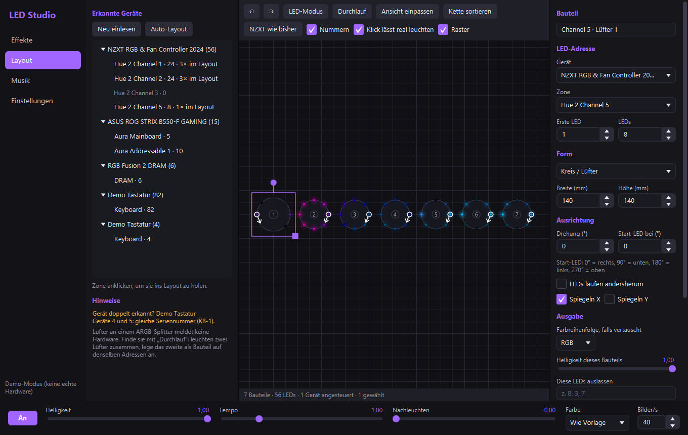
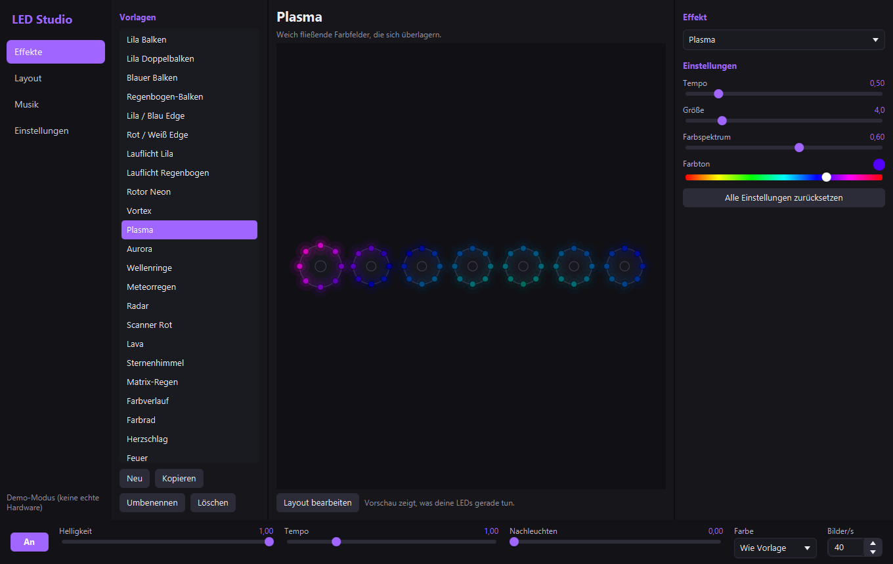

# LED Studio

RGB-Editor und Effekt-Engine für [OpenRGB](https://openrgb.org). LED Studio verbindet sich mit dem OpenRGB-SDK-Server, zeigt alle erkannten Geräte und lässt dich deinen Aufbau so anordnen, wie er wirklich im Gehäuse sitzt. Die Effekte laufen dann über die echte Lage jeder LED.



## Installation

1. [OpenRGB](https://openrgb.org) installieren und den SDK-Server aktivieren (LED Studio startet ihn auf Wunsch selbst).
2. Unter [Releases](https://github.com/Knirpslarsi/LED-Studio/releases/latest) die `LEDStudio-Setup-x.y.z.exe` laden und starten. Adminrechte sind nicht nötig.

Das Setup ist nicht signiert. Windows SmartScreen kann deshalb warnen: **Weitere Informationen → Trotzdem ausführen**.

Updates kommen von selbst: Die App prüft beim Start und alle 6 Stunden die Releases. Ist das Fenster offen, erscheint oben ein Hinweis. Läuft sie im Hintergrund, installiert sie das Update still (abschaltbar). Vor der Installation wird die SHA-256-Summe geprüft.

## Layout-Editor

- **Geräte erkennen:** Alle OpenRGB-Geräte mit Zonen, LED-Zahl und Segmenten. Neu angesteckte Geräte erscheinen automatisch.
- **LEDs pro Lüfter:** Eine Zone mit einem Klick in Lüfter aufteilen, z. B. 24 LEDs in 3 × 8. Vorhandene OpenRGB-Segmente lassen sich direkt übernehmen.
- **Form:** Kreis, Doppelring, abgerundetes Rechteck, Linie, Bogen, Raster oder ganz frei. Tastaturen kommen mit ihrer echten Matrix.
- **Ausrichtung:** Drehen, spiegeln, Position der ersten LED, Laufrichtung. Die weiß umrandete LED mit dem Pfeil zeigt Start und Richtung.
- **Einzelne LEDs:** Im LED-Modus verschieben oder per Strg-Klick dauerhaft ausschalten.
- **Doppelte Adressen:** Zwei Lüfter an einem ARGB-Splitter haben dieselben LED-Adressen und leuchten immer gleich. Das meldet keine Hardware; finde sie mit **Durchlauf** und lege das zweite Bauteil auf denselben Adressen an. LED Studio zeigt solche Paare an und rechnet sie korrekt zusammen.
- **Doppelt erkannte Geräte:** Gleiche Seriennummer oder gleicher Anschluss werden unter **Hinweise** gemeldet.
- **Real aufleuchten:** Klick auf ein Bauteil oder eine LED lässt genau diese in echt weiß leuchten.
- **In OpenRGB schreiben:** Zonengröße ändern und die Lüfter-Aufteilung als Segmente eintragen. Das fragt vorher nach, denn OpenRGB speichert es dauerhaft.

Bedienung: Ziehen verschiebt (Alt: ohne Raster), Griffe drehen und skalieren, Mausrad zoomt, rechte Maustaste verschiebt die Ansicht. Dazu Entf, Strg+Z/Y, Strg+D, Strg+A und Pfeiltasten.

Solange ein Effekt läuft, steuert LED Studio nur Geräte mit mindestens einem Bauteil im Layout. Alles andere bleibt unberührt. Nicht zugeordnete LEDs eines gesteuerten Geräts bleiben aus.

## Effekte und Ebenen

Eine Vorlage besteht aus beliebig vielen **Ebenen**. Jede Ebene ist ein Effekt auf einem frei wählbaren Ziel: alles, ein Gerät, eine Zone oder einzelne Lüfter. So läuft zum Beispiel Plasma auf der Tastatur, ein Rotor auf den Lüftern und ein Musik-Effekt auf dem Mainboard. Bauteile wählst du im Reiter **Ziel** oder per Klick in der Vorschau. **Je Gerät eine Ebene** teilt eine Ebene passend auf. Geräte ohne aktive Ebene bleiben unberührt.

Pro Ebene einstellbar (**Feinschliff**):

- **Überblendung:** Normal, Addieren, Aufhellen, Multiplizieren, Abziehen und Deckkraft
- **Farbe:** Farben des Effekts durch eine Farbe oder einen Verlauf ersetzen, Farbton, Sättigung, Helligkeit, Gamma
- **Zeit:** eigenes Tempo, Versatz, Nachleuchten
- **Bereich:** Effekt nur über das Ziel oder über den ganzen Aufbau, nur Rand-LEDs oder nur jede zweite LED, Laufrichtung, spiegeln, drehen, Muster-Größe
- **Musik:** Helligkeit folgt Bass, Mitten, Höhen oder Gesamtpegel

**Solo** zeigt beim Einstellen nur eine Ebene. Jeder Reglerwert lässt sich auch eintippen, auch über die Grenzen des Reglers hinaus.

Effekte: Rotor, Vortex, Pulsringe, Plasma, Aurora, Wellenringe, Meteorregen, Radar, Scanner, Lava, Sternenhimmel, Matrix-Regen, Farbverlauf, Farbrad, Herzschlag, Feuer, dazu der Balken über die Lüfterränder, Lauflicht, Regenbogen, Atmen, Komet, Welle, Statisch und Gegenwelle. Alle Regler sind pro Vorlage einstellbar und werden sofort live übernommen.



**Musik:** Für alle Geräte auf der Seite **Musik** oder pro Gerät als Ebene mit dem Effekt **Musik-Animation**. Jeder erkannte Beat startet einen eigenen Lauf, Läufe überlagern sich, es geht kein Beat verloren. Die Beat-Empfindlichkeit ist einstellbar.

- **Auf Beats:** Beat-Balken, Bass-Komet, Doppelwelle, Fan-Kaskade, Regenbogenlauf, Beat-Ringe (aus der Mitte oder aus jedem Bauteil)
- **Drei-Band-Beats:** Bass schickt Ringe aus der Mitte, Mitten eine Welle quer über den Aufbau, Höhen einen Funkenregen, jeder Bereich in eigener Farbe
- **Nach Frequenzen:** Equalizer mit 16 Bändern (tief links, hoch rechts, Füllung von unten), Frequenz-Zonen (Bass, Mitten, Höhen je ein Drittel der Kette), Bass-Pumpe mit Höhen-Funken, Tonhöhen-Farbe, Spektrum-Ringe, VU-Meter, Puls
- **Fester Takt:** Jede Animation läuft auf Wunsch ohne Ton in einem einstellbaren BPM-Takt. Als normaler Effekt gibt es dafür die **Pulsringe**.

Quelle ist der PC-Sound oder ein Mikrofon. Audio wird nur lokal ausgewertet, nie gespeichert oder übertragen.

**Eigene Effekte:** JavaScript-Dateien im Effekt-Ordner, siehe [docs/beispiel-effekt.js](docs/beispiel-effekt.js).

## Umstieg von der alten Python-Version

1. Das alte LED Studio im Tray beenden. Beide zusammen würden die LEDs flackern lassen.
2. Unter **Einstellungen → config.json importieren** Vorlagen und Einstellungen übernehmen.
3. Unter **Layout → NZXT wie bisher** die alte Lüfterkette anlegen (Channel 5 gespiegelt → 1 → 2, je 8 LEDs).
4. Unter **Einstellungen → Mit Windows starten** ersetzt die neue Version den alten Autostart-Eintrag.

Einstellungen und Layout liegen unter `%APPDATA%\LEDStudio`.

## Entwicklung

Das Projekt ist ein Gradle-Projekt und lässt sich direkt in IntelliJ IDEA öffnen. Es braucht JDK 21. Die Run-Konfigurationen **LED Studio** und **LED Studio (Demo)** werden mitgeliefert; die Demo läuft mit simulierter Hardware.

```bash
./gradlew test
```

```bash
./gradlew run --args="--demo"
```

```bash
./gradlew appImage
```

`appImage` erzeugt den Programmordner mit `LEDStudio.exe` unter `build/package/image`. `setupExe` baut zusätzlich das Setup und braucht [Inno Setup 6](https://jrsoftware.org/isinfo.php).

### Neue Version veröffentlichen

Ein Tag startet den Release-Build, der getestet wird und Setup samt Prüfsumme veröffentlicht. Danach finden alle Installationen das Update von selbst.

```bash
git tag v1.2.3 && git push origin v1.2.3
```

## Verwendete Bibliotheken

OpenJFX (GPLv2 + Classpath Exception), Gson (Apache 2.0), JNA (Apache 2.0 / LGPL), Mozilla Rhino (MPL 2.0). LED Studio ist kein offizielles OpenRGB-Projekt und spricht nur dessen SDK-Protokoll.
